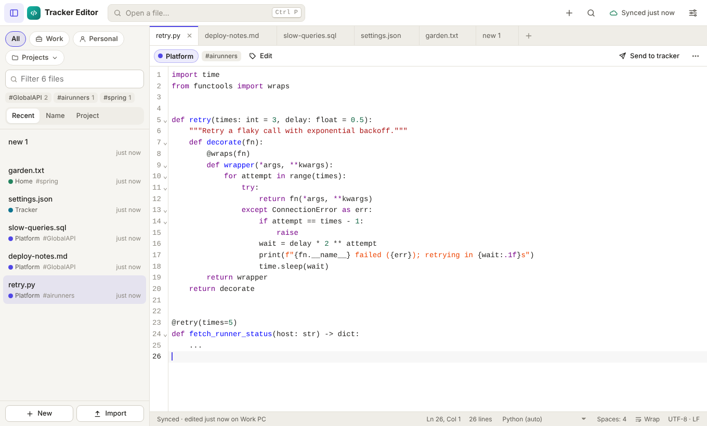
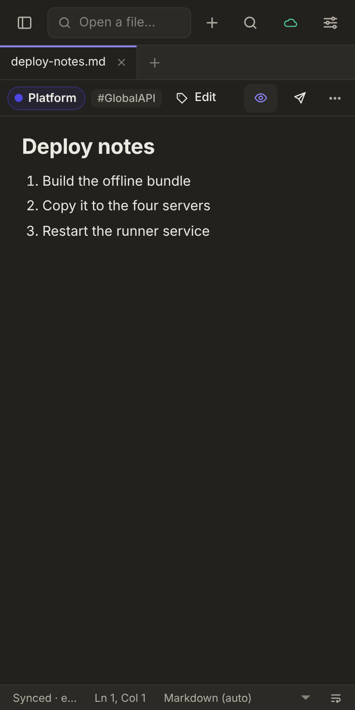

# Tracker Editor

A Notepad++-style text editor for the notes, snippets, logs and code you paste somewhere and want to find again. Keep dozens of files open in tabs; everything is saved as you type and synced to your **private GitHub data repository**, so you can read it on your phone and your other computers.

It is the companion of [Tracker](https://github.com/divaor/tracking_app) and shares its data repository: the same **projects** (Work / Personal) and **tags**, items sent from the editor show up on the tracker, and the tracker opens files in the editor.

 

## Features

- **Many files open at once**: tabs you can reorder, reopen closed tabs (`Ctrl+Shift+T`), untitled `new 1`, `new 2`… files like Notepad++. Your tabs and their text come back exactly as you left them, including untitled ones. With many tabs, the edge of the tab bar shows which way the open tab is and brings it back, and **▾** lists them all.
  - Right-click a tab (on a phone: its ⋯, or a long press) to **pin** it, open it **to the side**, see its history, compare it, or close others, those to the right, a project's tabs or all. Double-click a tab to pin it, middle-click to close it.
  - Many tabs: the mouse wheel scrolls the tab bar (no scrollbar), and an arrow with a count at each end says how many tabs are past it.
  - **Group tabs by project**, each group with a header that folds it.
  - **Split view** (`Ctrl+\`) on wide screens: two files side by side, both editable.
- **Where each file lives, at a glance**: every tab, the file bar, the status bar and a frame around the editor are colored by where the file is: **my files** (synced, green), a **tracker** document (blue), **this computer** (amber) or a **server** (pink). The file bar says how it stands: synced or not yet, saved or not, changed elsewhere, not connected.
- **Nothing is lost**: pasted text and new tabs are saved to disk immediately, and typing a moment after the last key. Every write waits until it is on disk, so a crash or a power cut keeps your work. The data repo then holds a copy too, synced a few seconds later.
- **Named and filed from their content**: an untitled tab you paste or write into gets a name that says what it is, from the local model when one is connected (for example `Deploy runbook.md`), otherwise from a heading on its first line. The model also files a new note under one of your projects, with a few tags. Undo puts back what it had.
- **History**: every synced version of a file or tracker document, with who changed it and when. Compare any version with the text now, side by side (one text with the changes marked on phones), then restore it, copy it or open it as a new file. **Compare with…** compares two files.
- **Trash**: deleted files can be restored for 180 days, on any device.
- **End-to-end encrypted files**: choose **Encrypt** in a file's menu and its text is stored in your data repo as ciphertext. Only your devices, with your passphrase, can read it.
- **Synced through GitHub**: every device keeps a full local copy and works offline. Changes are committed to `editor/` in your data repo, a batch at a time. If two devices edit the same file, nothing is lost: the other version is kept as a copy named after its device.
- **Projects and tags**: the tracker's projects and tags, the same Work / Personal filter, and new projects you create here appear in the tracker.
- **Tracker integration**:
  - **Send to tracker** turns a file into a task, idea or doc linked to it.
  - The tracker's documents (proposals, artifacts and other attached files) are listed with your files, under the name of their item. They are downloaded on each sync, so you can read them offline and find them with `Ctrl+P`, Find in files and the local model.
  - The tracker shows **Open in editor** on those items and **Edit in editor** on attached files; your edits are saved back to the tracker.
- **Search that knows where things are**:
  - `Ctrl+P` opens a file by (fuzzy) name or project; on the desktop also the files in the folders open in Folders (here and on servers), by name or by path (`lib/util`), opened in place.
  - `Ctrl+Shift+F` finds text in all files, the filtered ones or the open tabs, with case, whole-word and regex options. Tick the files found and open them together, or open all of them, each at its first match.
- **Outline, `[[links]]` and backlinks** (`Ctrl+Shift+O`): the headings of a Markdown file or the classes, functions and tables of code, to jump to. Write `[[another note]]` to link notes (Ctrl+click opens it, or offers to create it); the panel lists the links and the files that link here.
- **Snippets with fields** (`Alt+I`): mark files as snippets and insert them with their `{{fields}}` filled in, plus `{{date}}`, `{{clipboard}}`, `{{selection}}` and `{{cursor}}`. Insert, copy or type them into another window.
- **Log tools**: **Filter lines** (`Alt+L`) shows only the lines that match (or hides them), with regex; copy them or make a file of them. Very large files open in a lighter mode that stays fast.
- **Macros**: `Ctrl+Shift+R` records your edits, `Ctrl+Shift+P` plays them back, or run them many times or to the end of the file.
- **Compare with the clipboard**, and **send a checklist to the tracker**: the open `- [ ]` items of a file or the selection become tasks that link back to it.
- **A local model on your computer** (Ollama, LM Studio or any OpenAI-compatible server): summarize a file, ask questions about one or all of your files with sources, and **find by meaning** when you don't remember the words. Nothing leaves your machine.
  - **Help with the text**: the ✦ bubble at the bottom right (or `Ctrl+K`) works on the selection, or the whole file. Fix, rewrite, shorten or expand it; change the tone; **advanced replace** (say what to change: "every date to YYYY-MM-DD"); tidy it, **make it Markdown**, **convert it** to JSON, YAML, CSV, a table…; **check the syntax** of a query, find problems, add comments, rewrite it in another language or SQL dialect, write a regex; translate it; or ask anything and follow up. New versions open as a comparison to accept, keep as a new file or copy.
  - Or a **model service that answers later** (submit a request, get the answer from a status call or a webhook), described by a connection profile; see [4. Model](#4-model-optional).
- **Type into another window** (desktop): for remote desktops and consoles that do not take pasted text. `Alt+T` types the selection, or the whole file, as key presses into the window you click into before a short countdown ends.
- **Files on disk** (desktop): **File → Open File (Edit in Place)** (`Ctrl+O`) edits a file where it is, keeping its line endings and encoding. It reloads when the file changes elsewhere, warns before saving over someone else's change, and **Follow** shows new lines as they are written, like `tail -f`. Huge logs open by their last part.
- **Your editor in Explorer** (Windows): **Open with → Tracker Editor** for text and code files, **Edit with Tracker Editor** on any file and **Open in Tracker Editor** on folders; a file opened that way opens as a tab edited in place. macOS: Finder's **Open With**.
- **Folders** (desktop): the sidebar's **Folders** view (`Ctrl+Shift+E`) works like a file explorer for folders on your computer: open, create, rename, copy, cut and paste (to and from Explorer or Finder too), drag to move, delete to the Recycle Bin, sort, with Undo; a tree or columns, favorites and recent folders, a preview of pictures, PDFs and text (Space for a large view), compare two files, zip and unzip; find in a folder, **Properties** (sizes, dates, permissions) and **Open a terminal here**. Text files open as files on disk, edited in place and not synced unless you **Copy into my files**; other files open with their own program; pictures can have their text read into a file next to them.
- **Drag a tab out** (desktop): to the desktop or a folder for a copy, to a terminal running Claude Code for its path, or to the Claude app to attach it. **Copy for Claude** in the tab menu copies the path of a file on disk, or the name and text of the others.
- **Quick capture** (desktop): a shortcut that works in any app opens a small window to jot something down, kept as a new note or added to `Inbox.md`.
- **Clipboard history** (desktop, off until you turn it on): what you copy in any app, to search and paste again (`Ctrl+Shift+V`). Kept on the computer, encrypted, and passwords from password managers are skipped.
- **Files on servers** (desktop): connect to servers over **SFTP**, **FTPS** or **FTP** and work on their files as on your own: browse them in Folders, open, edit and save back, follow logs, rename, move, copy, upload and delete. The editor shows when a file is not saved to the server yet, changed there meanwhile, or the server cannot be reached.
  - Sign in with a password (asked when it is not saved), a key, your SSH agent and a **one-time code** when the server wants a second step; reach servers **through a jump host**; set them up from your **SSH config**.
  - **Terminal** (`` Ctrl+` ``): a shell on the server in a panel under the editor, opened in the folder you are looking at, with a tab per shell.
  - **Mirrors**: keep a folder on a server and one on this computer the same, both ways or one way, automatically while the server is connected. Files deleted here are deleted on the server only when you say so; a file changed on both sides is kept twice.
  - **Permissions**: see them next to the files, and change them (owner, group, others, or as `644`) in **Properties**.
  - **Transfers in the background**: uploads and downloads show in a **Transfers** card with a progress bar, speed and **Stop**, while you keep working.
- **Find in a folder** (desktop, `Ctrl+Shift+F` in Folders): text in a folder and the folders inside it, on this computer or on a server, with the same options as Find in files; the files found open at the line.
- **Text from images and screenshots**: paste, drop or pick an image (on a phone, take a photo), or on the desktop drag around part of the screen, and its text is read on the device (English and Spanish), or by your model when it reads images, to insert, keep or copy.
- **Voice notes** (phone and browsers with a speech service): the microphone button dictates into the open file or a new note, with spoken line breaks ("new line", "nuevo párrafo").
- **Syntax highlighting** for 140+ languages, detected from the file name or the content of pasted text, or picked in the status bar.
- **Find and replace** (`Ctrl+F`, `Ctrl+H`): match case, whole word and regular expressions as toggles in the field, how many matches and which one you are on, previous / next / select all, and Replace or Replace all on a second line.
- **Format document** (`Shift+Alt+F`): one-line JSON becomes readable (numbers and text kept exactly), and XML, SQL, JavaScript, TypeScript, CSS, HTML, Markdown, YAML and GraphQL are tidied too; the whole file or just the selection.
- **Help** (`F1`): every command and its shortcut in a searchable cheat sheet you can run commands from (or print), and the full guide.
- **Editing tools**: go to line, multiple cursors, select next occurrence, comment lines, duplicate/delete/sort lines, remove duplicates, trim trailing spaces, upper/lower case, format JSON, word wrap, visible whitespace, bracket matching.
- **Code tools** (not a full IDE): fold and unfold blocks, everything at once (`Alt+0` / `Alt+Shift+0`) or by level (`Alt+1`–`Alt+3`: classes, then their methods); **go to the declaration** (`F12`), **usages** (`Shift+F12`) and **rename** (`F2`) of a name in the file; **go to a function or section** (`Ctrl+P`, then `@`); the status bar names the function you are in; the name under the cursor is highlighted where else it is used. YAML and plain text fold by indentation.
- **Problems as you type**: mistakes are underlined in JSON (comments allowed in `tsconfig.json`, `.jsonc` and the like), YAML (also a key twice, tabs, an open quote), XML, HTML, CSS and code (JavaScript, TypeScript, Python, Go, Java, PHP, C/C++, Rust); the status bar counts them, `Ctrl+Shift+M` lists them, `F8` / `Shift+F8` go to the next / previous one.
- **Indentation per file**: tabs or spaces and how many, from the file's text or its `.editorconfig` (files on disk and on servers); the status bar shows it (`Spaces: 2`), changes it and converts the file. Indentation guides, brackets colored by depth, and sticky scroll (the lines of the class and function you are in stay at the top), each one can be turned off in Settings → Editor.
- **Preview**: a reading view next to the text (instead of it on phones):
  - Markdown, with clickable checklists
  - HTML pages, in a sandbox with scripts and links off
  - JSON and XML as trees you can fold, with the place of any syntax error
  - SVG as a picture
  - CSV and TSV as a table

  Drag the line between the text and the preview (or the side view) to give either more room; **Full view** shows only the preview, **Full screen** fills the screen with it.
- **Your layout**: drag the sidebar's edge to widen it (long names in folders); double-click a handle to go back to the default. Search and filter fields have an × to clear them.
- **Read aloud**: **Listen** (or `Alt+R`) reads the file from the cursor, or just the selection, and highlights the passage being read. You can pause, skip, change the speed and pick a voice.
  - It reads the way a person would: Markdown as prose, dates, abbreviations, `#7` and `v2` in words, asides and dashes as short pauses, and longer pauses after headings and paragraphs. Code blocks are skipped.
  - It uses your device's voices, picking the most natural one for the text's language (English, Spanish, Portuguese…).
  - For truly human-sounding voices, connect a speech server; see [5. Natural voices](#5-natural-voices-optional).
- **Share**: send a file by WhatsApp, Teams, email, Quick Share or any app on the phone (as text or as an attachment), or by email, WhatsApp or Teams on a computer. Copy the text, copy a link that opens it in the editor, or save a copy.
- **Share to the editor** (Android): in any app, **Share → Tracker Editor** saves the text or file as a new file that syncs like the rest. On a computer, Chrome and Edge can also open text files with the installed app.
- **Also**: light and dark theme, import files from disk (drag and drop works), save a copy to disk, keyboard shortcuts, and home screen shortcuts for a new note or a voice note.

## How it fits together

```
  Work PC  (Electron) ─┐                                    ┌─  tracker.json      (items, projects; shared with the tracker)
  Home PC  (Electron) ─┼──▶  GitHub API  ──▶  private repo  ┼─  editor/index.json (file names, projects, tags)
  Phone    (web app)  ─┘                                    └─  editor/files/<id>/<name>   (the text)
```

The app code (this repo) and your data are kept apart. The editor uses the same data repository and token as the tracker.

---

## 1. Connect to your data repo

1. Set up the tracker first (see its README): a private data repository and a fine-grained token with **Contents: Read and write** on it.
2. In the tracker, open **Settings → Sync with GitHub → Copy setup code** (with the token).
3. In the editor, open **Settings**, paste the code into **Setup code**, press **Apply**, give the device a name and press **Save**.

## 2. Desktop (work PC, home PC)

Download the installer from the **Releases** page:

- **Windows**: an installer, plus a portable `.exe` that needs no admin rights
- **macOS**: a `.dmg`
- **Linux**: an `AppImage`

The builds are not code-signed, so the first launch shows a warning (Windows: *More info → Run anyway*; macOS: right-click → *Open*).

Installing the desktop app also registers `tracker-editor://` links, so the tracker's desktop app opens files straight in it. Without it, links open the web version.

To publish a release, run **Actions → Release desktop app → Run workflow** with a tag such as `v0.1.0` (it must match `package.json`), or push the tag.

## 3. Phone

1. In this repo, go to **Settings → Pages → Build and deployment → Source** and choose **GitHub Actions**. The *Deploy web app to GitHub Pages* workflow publishes `app/` on every push to `main`.
2. On your phone, open `https://divaor.github.io/tracker-editor/` and install it (iPhone: Share → **Add to Home Screen**; Android: ⋮ → **Install app**).
3. Connect it with the setup code as in step 1.
4. To send text or files from other apps to the editor, use their **Share** button and pick **Tracker Editor**. If it isn't in the list, remove the app from your home screen and install it again: Android only reads the list of what an app accepts when it is installed.

The tracker's **Open in editor** links point at this address. If you host the editor elsewhere, set the address in the tracker under **Settings → Tracker Editor**, and in the editor under **Settings → This device → Links to files**.

## 4. Model (optional)

### A local model (desktop)

1. Install [Ollama](https://ollama.com) and start it.
2. Pull a chat model and an embedding model:
   ```sh
   ollama pull llama3.2
   ollama pull nomic-embed-text
   ```
3. In the editor, open **Settings → Model → OpenAI-compatible server**, press **Ollama**, then **Test and list models**, pick the two models and press **Save and turn on**.
4. Open the assistant with the ✦ button or `Ctrl+Shift+A`:
   - **Ask**: questions about this file, the filtered files or all files, answered with links to the passages it used.
   - **Find by meaning**: the passages closest in meaning to what you type.
   - **Summarize**: a summary of the open file.

The desktop app talks to the model through its main process, so no extra setup is needed. In the browser, Ollama must allow the site's origin: set `OLLAMA_ORIGINS=https://divaor.github.io` and restart Ollama. LM Studio works too (its server runs on `http://localhost:1234/v1`).

Finding by meaning keeps an index of your files on the device and only re-reads files that changed.

### A model service that answers later

Some model services do not answer in the same request: you submit a question, get a task id back, and the answer comes later from a status call, or the service posts it to a webhook. **Settings → Model → Service that answers later** connects one. You describe the service in a **connection profile** (JSON); **Start from the example** fills in one for a made-up service:

```json
{
  "submit": {
    "url": "https://ai.example.com/api/tasks",
    "body": { "prompt": "{{prompt}}", "model": "{{model}}", "callback_url": "{{webhook_url}}" },
    "taskId": "id"
  },
  "status": {
    "url": "https://ai.example.com/api/tasks/{{task_id}}",
    "method": "GET",
    "state": "status",
    "done": ["done"],
    "failed": ["failed"],
    "answer": "result.answer",
    "error": "error.message"
  },
  "auth": { "header": "Authorization", "prefix": "Bearer " }
}
```

- `submit` sends the question; `taskId` says where the task id is in its answer (paths like `data.0.id`).
- `status` asks how the task is going; `state`, `answer` and `error` are paths in its answer, and `done` / `failed` the states that end it. Add `rev` (the path of a revision) when the service can hold the status call open until the task changes: the next call sends it as `{{rev}}`. Otherwise the app asks every `interval` seconds (2 by default).
- Placeholders: `{{prompt}}`, `{{model}}` (the *Model or agent name* field), `{{task_id}}`, `{{rev}}`, `{{webhook_url}}`, `{{date}}`, `{{purpose}}` (`ask`, `summarize`, `name`, `file`, `test`) and `{{app}}`. A value that is only a placeholder keeps its type (a number stays a number) and is left out when empty.
- Optional: `status.sources` (sources listed under the answer), `headers`, `ok` (a field that must be true in every answer), `errorMessage`, `timeout` (seconds, 300 by default) and `webhook`.
- The API key goes in its own field. The desktop app keeps it in the system keychain; it is never part of the profile or the settings.
- **Webhook** (desktop app): turn on *Receive answers by webhook*, choose a port, and enter the address the service can reach this computer at; it goes into `{{webhook_url}}`. With a webhook secret, each event must carry the HMAC-SHA256 of its body (hex) in the header the profile's `webhook.signatureHeader` names; anything else is refused. The app keeps checking the status now and then, since deliveries can be lost.

Requests from the desktop app go through its main process, with your system's certificates and proxy, so services on a company network work without browser settings. Finding by meaning needs an embedding model, so it stays with OpenAI-compatible servers.

## 5. Natural voices (optional)

Device voices range from robotic to good, depending on the device; **Settings → Read aloud** explains how to install better ones. For voices that sound like a person reading, use a speech server with an OpenAI-compatible API (`/v1/audio/speech`). Its audio plays like music: with controls on the lock screen, and it keeps reading with the screen off.

- **Kokoro on your computer** (free, private): install Docker and run
  ```sh
  docker run -d -p 8880:8880 --restart unless-stopped ghcr.io/remsky/kokoro-fastapi-cpu:latest
  ```
  In **Settings → Read aloud → Speech server**, press **Kokoro (this computer)**, then **Save** and **Hear a sample**. Voices: `af_heart`, `af_bella`, `am_michael`, `bf_emma`… for English, `ef_dora` for Spanish and `pf_dora` for Portuguese. Under *Voices for other languages*, list one per language (`es=ef_dora, pt=pf_dora`) and each file is read in its own language.
- **OpenAI** (paid, works on the phone too): press **OpenAI**, paste an API key, and describe the reading style you like. `gpt-4o-mini-tts` follows it, for example "a warm audiobook narrator with natural pauses".

A server at `localhost` is only reachable from the computer it runs on; on a phone, use one with an `https` address.

## 6. Encrypted files (optional)

1. In **Settings → Encryption**, set a passphrase. It is the same on every device, and **nothing can recover your encrypted files if you forget it**.
2. In a file's menu (⋯), choose **Encrypt**. From the next sync, its text is stored in the data repo as AES-GCM ciphertext; its name, project and tags are not encrypted. Earlier versions in the repo's history stay as they were.
3. On your other devices, open the file (it shows a lock) or **Settings → Encryption**, and unlock with the passphrase once.

`editor/vault.json` in the data repo holds the salt and a check value, never the passphrase or the key. An unlocked device keeps the text of encrypted files so they work offline; **Lock this device** keeps only the ciphertext there until you unlock it again. The Claude connector can list encrypted files but not read or change them.

## 7. Typing into another window (desktop)

For remote desktops, virtual machine consoles and other windows that do not take pasted text:

1. Select some text, or select nothing to type the whole file.
2. Press `Alt+T` (or **Edit → Type into Another Window**, or **Type into another window** in the file's menu).
3. Click into the window to type into before the countdown (5 seconds) ends.

It stops when another window takes the focus, when you hold `Escape` (Windows), or with **Stop**. It never types into the editor itself. In **Settings → Typing into other windows** you can change the countdown and the speed (slower for laggy connections), and minimize the editor while it types. For editors that indent new lines by themselves (VS Code, SSMS, Notepad++…), turn on **The other editor indents new lines by itself**: after each line break the indentation it added is cleared and the text's own is typed, so YAML and Python keep exactly theirs.

- **Windows**: works as is (key presses as scan codes, which remote desktop clients pass on).
- **macOS**: allow Tracker Editor under **System Settings → Privacy & Security → Accessibility** the first time.
- **Linux**: needs `xdotool` (X11) or `wtype` (Wayland).

## 8. Files on disk and logs (desktop)

**File → Open File (Edit in Place)…** (`Ctrl+O`) opens files from your computer without copying them into your synced files. `Ctrl+S` saves them back with their line endings (CRLF or LF), BOM and encoding (UTF-8 or Windows-1252); the status bar shows which.

- When a file changes on disk and you have no unsaved edits, it reloads by itself. When you do, a notice offers **Compare**, **Reload** or **Keep mine and save over it**; saving never silently overwrites someone else's change.
- **Follow** shows the lines added to a log as they are written (read-only meanwhile), and starts over when the log is rotated.
- Files over 20 MB open by their last 5 MB, read-only. **Filter lines** (`Alt+L`) and the lighter editor for big files help with long logs.
- **Copy into my files** in the ⋯ menu makes a synced copy. The app only reads and writes files you picked in its open dialog, and files inside folders you picked.

### Folders

The sidebar has two views on the desktop: **My files** (synced) and **Folders** (on this computer). **View → Folders** (`Ctrl+Shift+E`) shows it; **File → Open Folder…** adds a folder.

- Pick a folder in the system dialog (or start the dialog in Documents, Desktop or Downloads). The app can reach what is inside the folders you picked and nowhere above them; links that lead outside are refused, and a picked folder itself is not renamed, moved or deleted from here.
- **Selecting**: click, `Ctrl`+click, `Shift`+click, `Ctrl+A`, the arrow keys (`Shift` to extend), or type the start of a name. The line at the bottom counts the items and what is selected.
- **Opening**: double-click or `Enter`. Folders open in the view (`Backspace` or ↑ goes back, the path at the top jumps). Text files open as files on disk (as with `Ctrl+O`): saving, reloading and **Follow** work the same, and they are not synced. PDFs, pictures, Office files and other formats open with their own program. Programs, scripts and shortcuts (`.exe`, `.bat`, `.ps1`, `.lnk`…) are never started: scripts open as text, the rest only with **Show in the file explorer**.
- **A tree**: the chevron next to a folder (or `→` / `←`) opens it in place, with what is inside under it; select, copy and move across the folders you opened. New file, paste, duplicate, zip and text from images work in the folder of what you picked, not the top of the tree.
- **Filter**: what matches shows as you type, also in the folders inside (closed ones too, and on servers), under its folders; `*.yml` patterns work.
- **Side by side**: open several folders at once, here and on servers, each a root of the tree under a header in the color of where it is. Collapse one to look at another (or **Show only this one**), move and copy files between them, and the one you work in always stands out.
- **Details** (the columns button): name, size and date modified in columns (permissions too on servers); click a header to sort by it, again to turn it around.
- **Favorites and recent folders**: the ☆ in the folder's bar (or right-click a folder) adds it to the favorites under it, one click away and a place to drop files on; the 🕘 menu lists the folders you visited last.
- **Preview** (the eye button): the file you pick, under the list: pictures, PDFs, Markdown, HTML, CSV and JSON as they look, the start of other text files. Drag its top edge to resize it. **Space** shows the file large over the window, `←` / `→` go through the folder, `Enter` opens it, `Esc` closes it.
- **Changing**: **New file**, **New folder** (`Ctrl+Shift+N`), **Rename** (`F2`), **Cut** / **Copy** / **Paste** (`Ctrl+X` / `Ctrl+C` / `Ctrl+V`), **Duplicate**, **Delete** (`Del`, to the Recycle Bin or the Trash after asking). A copy in the same folder is named "… - Copy". When names are already where you paste, drop or move, you choose: **Replace** (the old ones go to the Recycle Bin; on servers they are deleted), **Keep both** (the new ones get " (2)") or **Skip**. Rename, move, copy and paste can be undone from their message.
- **With your file explorer**: files you copy or cut here can be pasted in Explorer, Finder or your Linux file manager, and files copied there are pasted here as copies (the originals stay). Text copied anywhere becomes a new file; you name it first.
- **Compare the two**: select two text files and right-click: they open side by side.
- **Zip**: **Compress to a zip** (right-click) makes a `.zip` of what is selected next to it; **Extract into a new folder** unpacks one beside it. Names that would land outside that folder are left out, and an archive that expands far beyond its size is not extracted.
- **Dragging**: drag files and folders onto a folder (or a part of the path at the top) to move them there, with `Ctrl` to copy; onto a file inside an opened folder, they go into that folder. In long lists, **Scroll up** / **Scroll down** bands at the edges scroll while you hold the pointer there, and a closed folder held under a drag opens. Drop files from another app to copy them in, or a tab to save a copy of it there. Dragged out of the window they go to other apps as the files themselves.
- **Open files follow**: renaming or moving a file, or the folder it is in, keeps its tab (with any unsaved edits). Deleting it closes the tab, unless it has unsaved edits.
- **Pictures**: right-click → **Text from the image…** reads its text on this computer; **Save as photo.txt here** keeps it next to the picture (or insert it, copy it, or make a synced file).
- **Find in this folder** (`Ctrl+Shift+F` in the list, the 🔍 button, or right-click a folder): finds text in the folder and the folders inside it, with match case, whole word and regular expressions, and **Files** to narrow it (`*.log, !debug*`). Press `Enter` to start; results come in as files are read, **Stop** stops it, and a line opens the file there. `.git`, `node_modules`, files that are not text and very large files are left out, and so are hidden files unless you tick **Hidden**.
- **Properties** (`Alt+Enter`, or right-click): where it is, its size (a folder's when you ask), dates, owner and permissions. On macOS and Linux (and on servers) change who can read, write and run it, or type a number like `644`; for a folder, also everything inside it (folders inside stay open wherever they can be read, and files can run only if they could before). On Windows, **Read-only**.
- **Open a terminal here** (right-click): your system's terminal app (Windows Terminal or PowerShell, Terminal on macOS, your desktop's on Linux) in that folder.
- **Also**: sort by name, date modified, size or type (⋯ or right-click on empty space, or the column headers); show hidden files; the list follows changes made in other apps; **Copy path**, **Copy for Claude** (paths, quoted as a terminal takes them), **Copy into my files**, **Show in the file explorer**; switch between your folders, add one or forget one from ⋯.
- The folders, the one you were in, the order and the files you had open are remembered.

### Dragging tabs to other apps

Drag a tab out of the window and drop it on another app. The app gets a file, and decides what to do with it:

| Dropped on | File on disk | Synced file or tracker document |
| --- | --- | --- |
| The desktop or a folder | A copy of the file | A copy, named after the tab |
| A terminal (Claude Code) | Its path is typed in | The path of a copy is typed in |
| The Claude app (desktop or browser) | Attached | Attached |
| Another editor (VS Code, Notepad++) | Usually opened | Usually opened (the copy) |

- The app you drop on decides what happens; the editor offers the file to copy, never to move, so the original stays where it is. A drop cannot make Explorer open the folder where a file lives; use **Show in folder** in the tab menu for that.
- The copies of synced files are written to a temporary folder (`Tracker Editor drag`) and removed after a week. Encrypted files are never written out: their tabs only move within the tab bar.
- Dropped back on the tab bar, the tab moves there, as before. On the web app, a dragged tab carries its text, so dropping it into a chat box or another app's text field pastes it.
- **Copy for Claude** (tab menu, or ⋯): for a file on disk, its path (quoted when it has spaces), which Claude Code reads where it is; for the others, the name and the text in a code block, ready to paste into a chat.

## 9. Files on servers (desktop)

**File → Connect to a Server…**, or **Connect to a server…** in Folders, adds one: **SFTP** (over SSH), **FTPS** (FTP over TLS) or **FTP** (not encrypted: only where nothing else is available).

- Sign in with a **password**, a **key file** (with its passphrase, if it has one) or, for SFTP, your **SSH agent**. Passwords and passphrases are kept in this computer's keychain, never in the editor's settings or your data repo, and are not shown again. **Test** tries the settings before you save them.
- The first SFTP connection shows the **server's key fingerprint** to check (as `ssh-keygen -lf` prints it); it is remembered. If it ever changes, the editor asks before connecting, since that can mean someone is in between.
- The server opens in **Folders**, starting in your home folder (or the folder you set). Everything in the folders view works there: open, new file or folder, rename, cut, copy and paste, duplicate, drag onto folders, delete (for good: servers have no Recycle Bin, so it asks first), and files pasted or dropped from your computer are uploaded. Copying between your computer and a server goes both ways. Pictures and other files open with their program from a downloaded copy.
- Uploads and downloads go on in the background, in the **Transfers** card (bottom left): a progress bar per transfer with how much, how fast and which file, and **Stop** (what got there stays; the file it was on is removed there). FTP transfers use a connection of their own, so the folder can be browsed meanwhile. Files are written under a temporary hidden name and renamed when complete.
- A file from a server opens in a **pink** tab, with the server's name in the file bar and the status bar (`SFTP · user@host:/path`, and a dot for the connection). It is not synced: **Ctrl+S** saves it to the server, and until then the tab says **Not saved to the server**. Turn on **Save to the server automatically** in the server's settings to save a moment after you stop typing.
- Changes made on the server show up in tabs you have not edited; with your edits, the file bar offers **Compare**, **Reload** or **Keep mine and save over it**, so nothing is overwritten by surprise. **Follow** shows lines added to a log on the server.
- If the server cannot be reached, your edits stay on this device (also across restarts), the tab says **Not connected · not saved**, and **Reconnect** brings it back.
- **Find in this folder**, **Properties** and the rest of the folders view work on servers too; **Show permissions** (⋯) puts `rw-r--r--` next to each file.

### Signing in

- **A password that is not saved** is asked when you connect, with **Remember on this computer** to keep it in the keychain. One the server refuses is asked again.
- **Two-step sign-in**: when the server asks more (a one-time code after the key or the password, or its own questions), they are shown as it asks them. Codes go to the server only and are never kept. A server that only asks for "Password:" this way gets the saved password without asking.
- **Key files with a passphrase** that is not saved: the passphrase is asked (and can be remembered).
- **Jump hosts** (bastions): in the server's settings, **Reach it through** another SFTP server set up here. It is connected first and opens the way, as `ssh -J` does; chains work too.
- **From your SSH config**: **Servers from your SSH config…** (⋯ in Folders, **File** menu, or the server dialog) lists the `Host` entries of `~/.ssh/config` (including `Include`d files). Tick the ones to set up: their host names, users, ports, key files (`IdentityFile`) and jump hosts (`ProxyJump`) come along; servers set up already are reused. Passwords are not in the SSH config, so they are asked the first time. `ProxyCommand` is not run; set a jump host instead.
- Reading a key fingerprint or typing a code can take as long as you need: the connection waits for you.

### Terminal

`` Ctrl+` ``, **View → Terminal**, **Open a terminal here** on a folder of an SFTP server (or **Open a terminal in its folder** for a file) opens a shell on the server in a panel under the editor, signed in like its files (same password, key, agent, code and jump host).

- Each shell has its own tab; **+** opens another on any SSH server. Drag the top edge to resize the panel.
- Keys go to the shell, not to the editor: `Ctrl+C` interrupts (or copies when text is selected), `Ctrl+V` pastes, `Ctrl+Shift+C` / `Ctrl+Shift+V` copy and paste too, and the editor's shortcuts are left alone. Right-click for copy, paste and clear.
- Hiding the panel (`` Ctrl+` `` again, or ⌄) keeps the shells running. When a shell ends, `Enter` starts a new one; closing its tab ends it.
- FTP servers have no shell. For a folder on this computer, **Open a terminal here** opens your system's terminal app.

### Mirrors

Keep a folder on a server and a folder on this computer the same, for working with your own tools on the files of a server.

- On a server in Folders, right-click a folder (or empty space) → **Keep on this computer (mirror)…**. Choose or make the folder here, the direction and what to leave out (`.git`, `node_modules` and temporary files by default), and **Save and sync now**.
- **Both ways**: what changes on one side goes to the other. **Server → here** brings the server's changes and sends none (the server wins); **Here → server** the other way round.
- **Keep them the same automatically**: while the server is connected, every minute and a few seconds after you change something here. **Sync now** is always there: in the bar shown inside a mirrored folder, the ⇄ badge of a file from it, and **Mirrors…** (⋯ in Folders), which lists them all.
- **Deleted on the server** → here it goes to the Recycle Bin. **Deleted here** → the editor asks before deleting on the server: **Delete on the server**, or **Bring them back here**. Until you answer, they stay on the server.
- **Changed on both sides**: yours keeps its name, and the server's version is kept next to it as `name (server copy 2026-10-22 15.04).ext`, on both sides. Files that are the same on both sides are no conflict.
- If one side suddenly looks empty (a drive not plugged in, the wrong server folder), nothing is changed and the bar says why.
- Large files are copied whole, streamed. A mirror's folder here is one of your folders, so it is in Folders too.

## 10. Quick capture, clipboard history and screenshots (desktop)

All three are in **Settings → Desktop**, off until you turn them on.

- **Quick capture**: a global shortcut (`Ctrl+Alt+N` by default; click the field and press the keys you want). Write, then `Ctrl+Enter` keeps it as a new note without leaving what you were doing, or adds it to `Inbox.md` under the time; `Ctrl+Shift+Enter` uses the other choice. `Escape` keeps the draft for next time.
- **Text from a screenshot**: an optional global shortcut (`Ctrl+Alt+O`), or **Edit → Text from a Screenshot**. The editor steps aside, you drag around part of the screen, and its text is read on this computer. On macOS, allow screen recording the first time.
- **Clipboard history** (`Ctrl+Shift+V`): texts you copy in any app, newest first. Search them, insert one at the cursor, copy it again, open it as a file or type it into another window; pin the ones to keep. They stay on this computer, encrypted with its keychain; copies password managers mark as secret are skipped, and turning it off forgets the history.
- **Keep running in the tray when the window is closed**, so the shortcuts and the history keep working.

## 11. Text from images and voice notes

- **Images**: paste an image into a file, drop one on the window, pick one with **⋯ → Text from an image…** (on a phone you can take a photo), or share one to the editor from another app. The text is read on the device by [Tesseract](https://github.com/naptha/tesseract.js) in English and Spanish (pick one language for better results), shown to correct, then inserted, kept as a new file or copied. The first time loads about 9 MB; after that it works offline.
  - **With your model**: when the connected model reads images (a vision model such as `llama3.2-vision`, `qwen2.5vl` or `gemma3`, set as **Model for images** in Settings → Model), **Read by** in the dialog switches to it. It often does better with photos, handwriting and tables (kept as Markdown tables). The image goes to your model server; a local one keeps it on your computer. The choice is remembered.
- **Voice notes**: the microphone button at the top dictates into the open file, or a new note when none is open; **Voice note** on the installed app's icon (long-press it on Android) starts one. Say "new line" or "new paragraph" ("nueva línea", "nuevo párrafo", "punto y aparte") for line breaks. It uses the browser's speech service (on Android, Google's), so it needs a connection; pick the language in **Settings → Voice notes**. The desktop app has no speech service, so dictation is not there.

## Keyboard shortcuts

| Keys | Action |
| --- | --- |
| `Alt+N` (desktop: `Ctrl+N`) | New file |
| `Ctrl+P` | Open a file by name |
| `Ctrl+Shift+F` | Find in files |
| `Ctrl+O` | Open a file from disk to edit in place (desktop) |
| `Ctrl+Shift+E` | Folders on this computer and on servers (desktop) |
| In the folders view | `Enter` open, `Backspace` up, `F2` rename, `Del` delete, `Ctrl+C` / `Ctrl+X` / `Ctrl+V`, `Ctrl+A`, `Ctrl+Shift+N` new folder, `F5` refresh, `Alt+Enter` properties, `Ctrl+Shift+F` find in this folder |
| `` Ctrl+` `` | Terminal: show or hide (desktop) |
| In the terminal | `Ctrl+Shift+C` / `Ctrl+Shift+V` copy / paste (`Ctrl+C` copies when text is selected, `Ctrl+V` pastes) |
| `Ctrl+F` / `Ctrl+H` | Find / replace in this file |
| `Ctrl+G` | Go to line |
| `Ctrl+Shift+M` / `F8` / `Shift+F8` | Problems in this file / next one / previous one |
| `Ctrl+D` | Select the next occurrence |
| `Ctrl+/` | Comment lines |
| `Alt+Z` | Word wrap |
| `Alt+R` | Read aloud, pause or resume |
| `Alt+T` | Type the selection or file into another window (desktop) |
| `Ctrl+K` | Ask the model about the selection or the file |
| `Alt+I` | Insert a snippet |
| `Alt+L` | Filter lines |
| `Ctrl+Shift+O` | Outline and links |
| `Ctrl+Shift+R` / `Ctrl+Shift+P` | Record a macro / play it |
| `Ctrl+Shift+V` | Clipboard history (desktop) |
| `Ctrl+\` | Split view: open or close the side pane |
| `Ctrl+B` | Show or hide the file list |
| `Ctrl+Shift+A` | Model |
| `Ctrl+S` | Sync now, or save a file opened from disk |
| `Ctrl+W` / `Ctrl+Shift+T` | Close tab / reopen it (desktop) |

## Data format

`editor/index.json` lists the files; the text of each file is stored next to it under `editor/files/<id>/<name>`, so you can also read your files on github.com.

```json
{
  "app": "tracker-editor",
  "schema": 1,
  "updatedAt": "2026-10-21T09:15:00.000Z",
  "files": [
    {
      "id": "mgx1k2-4f9c0a7b1e2d3c4f",
      "name": "deploy-notes.md",
      "project": "Platform",
      "tags": ["GlobalAPI"],
      "language": "",
      "sha": "…",
      "size": 812,
      "modifiedAt": "…",
      "modifiedBy": "Work PC",
      "createdAt": "…",
      "updatedAt": "…",
      "updatedBy": "Work PC"
    }
  ]
}
```

- Names, projects and tags merge per file: the most recent change wins (`updatedAt`).
- Text changes are tracked by the blob `sha`. When two devices changed the same file, the one syncing second keeps its version and the other is saved as a copy.
- Deleted files are kept as small `{ "id", "deleted": true, … }` records for 180 days, so the deletion reaches every device, and the trash can bring them back.
- An encrypted file has `"encrypted": true`, and its text in the repo starts with the line `TRACKER-EDITOR-ENCRYPTED v1`. `editor/vault.json` holds the passphrase's salt (PBKDF2-SHA256) and a check value.

## Development

```sh
npm install
npm test          # unit tests (node:test): sync engine, search, local model client
npm run web       # serve the web app at http://localhost:8080
npm start         # run the desktop app
npm run vendor    # re-bundle CodeMirror and xterm.js, copy Preact/htm, marked, DOMPurify and tesseract.js into app/vendor/
```

The web app is plain ES modules with no build step. CodeMirror 6 and its languages are bundled once by `npm run vendor` (esbuild, one chunk per language) into `app/vendor/cm/`; [xterm.js](https://xtermjs.org/) with its fit add-on into `app/vendor/xterm/` (the terminal, loaded when one opens); text recognition (tesseract.js, its WebAssembly core and the English and Spanish models) is copied into `app/vendor/ocr/`.

The desktop app's only runtime dependencies are [ssh2](https://github.com/mscdex/ssh2) (SFTP) and [basic-ftp](https://github.com/patrickjuchli/basic-ftp) (FTP, FTPS), both plain JavaScript. ssh2's optional native speed-ups are left out of the installers (`build.files` in package.json), so builds need no compiler; it uses its JavaScript and WebAssembly code instead.

```
app/                  the web app (also loaded by Electron)
  js/model.js         file records, merge rules, paths in the data repo
  js/sync.js          one sync round with the Git Data API (one commit per round, conflict copies)
  js/github.js        GitHub client (Contents and Git Data APIs)
  js/tracker-model.js copy of the tracker's model.js, for tracker.json
  js/store.js         local store (IndexedDB): files, text, open tabs
  js/editor.js        CodeMirror setup, one editor state per tab
  js/search.js        find in files, quick open
  js/llm.js, ai.js, semantic.js   local model client, prompts, the meaning index
  js/asyncLlm.js      client for model services that answer later (profiles, polling, webhooks)
  js/versions.js      file history from the data repo's commits
  js/crypto.js, vault.js          encrypted files: AES-GCM, the vault, the key on this device
  js/naming.js        names and filing for new notes
  js/typing.js        text prepared for typing into another window
  js/selectionAsk.js  what the model panel can do with the selection or a file
  js/snippets.js, outline.js, logtools.js, checklist.js   snippets, outline and [[links]], line filters, checklists
  js/diskTabs.js      files on disk edited in place, reloads and follow mode
  js/folders.js, dragOut.js       the folders view (paths, order, selection, Copy for Claude), dragging tabs and files out
  js/where.js, servers.js         where a file lives (kinds, colors, states), the servers and their connections
  js/terminals.js, mirrors.js     terminals on servers (xterm.js sessions), mirrors and their status
  js/capture.js, ocr.js, ocrEngine.js, dictation.js       quick capture, text from images, voice notes
  js/ui/              tabs, sidebar, panels, dialogs, model panel, settings, compare, history, trash
  capture.html, snip.html   the quick capture window and the screenshot overlay (desktop)
  sw.js               offline cache
electron/             main process + preload (app:// protocol, keychain, model proxy, webhook receiver, tracker-editor:// links,
                      tray, global shortcuts, clipboard history, screen capture)
  typer.cjs           key presses into another window (Windows, macOS, Linux)
  diskFiles.cjs       reading and writing files on disk (encodings, line endings, the end of huge files)
  folders.cjs         which paths the page may reach in picked folders, listings, rename/move/copy, what may open outside
  remote.cjs          servers: SFTP (ssh2) and FTP/FTPS (basic-ftp), signing in, jump hosts, host keys, files, folders, shells
  sshConfig.cjs       the hosts of ~/.ssh/config
  findInFolder.cjs    find in a folder, here or on a server
  mirror.cjs          mirrors: what a sync does (pure) and doing it
  clipHistory.cjs     the clipboard history list
scripts/              vendor bundling, icon rendering, local web server
test/                 unit tests
.github/workflows/    CI, GitHub Pages deploy, desktop release builds
```

## Security notes

- **Token storage**: the desktop app encrypts the token with your operating system's keychain (Electron `safeStorage`); the web app keeps it in that browser's local storage. Use a fine-grained token limited to the data repo.
- **Markdown preview** is sanitized with DOMPurify, and the page runs under a strict Content Security Policy.
- **Desktop app**: the window is sandboxed with context isolation; the model proxy only accepts `http(s)` requests, and outside links open in your default browser.
- **Encrypted files**: AES-GCM with a 256-bit key derived from your passphrase (PBKDF2-SHA256, 600,000 rounds). The key is kept on unlocked devices as a non-extractable key; the passphrase is never stored.
- **Model service secrets**: the API key and webhook secret are kept in the keychain (desktop) and never written to the settings or the data repo. The webhook receiver refuses events whose signature does not match when a secret is set.
- **Files on disk**: the page can read and write only files you picked in the desktop app's open dialog, and files inside folders you picked there (symbolic links resolved, so they cannot lead outside). A forgotten folder is out of reach again. Renaming, moving, copying and deleting stay inside the picked folders, deleting goes to the Recycle Bin, and files pasted or dropped from other apps are copied in without becoming reachable themselves.
- **Other programs**: files open with their default program only when they are not programs, scripts or shortcuts, so a page can never start one.
- **Servers**: passwords and key passphrases are kept by the main process in the keychain store and never sent to the page; key files can only be ones picked in the file dialog, or named by `IdentityFile` in your SSH config (read by the main process; the page only picks hosts by name). Answers to the server's questions go to the server only: one-time codes are never kept, passwords only when you tick **Remember**. SSH host keys are checked against the fingerprint you trusted (for each server, also those reached through a jump host), and a changed key stops the connection unless you accept it. FTPS checks the server's certificate unless you allow a self-signed one; FTP is marked as unencrypted.
- **Terminal**: keys typed in it go only to the shell on the server; the editor's own shortcuts do not see them while it has the focus.
- **Mirrors**: deleting on a server waits for your yes; deleting here goes to the Recycle Bin; a side that suddenly looks empty stops the sync without changing anything. Local mirror folders are picked in the dialog like other folders.
- **Dragged tabs**: synced files dragged out are written as plain copies to a temporary folder, deleted after a week; encrypted files are never written out.
- **Clipboard history** is off by default, kept only on the computer (encrypted with the keychain; in memory only when there is none), skips copies marked as secret by password managers, and is deleted when turned off.
- **Text from images** runs in the page: images are never uploaded. **Voice notes** use the browser's speech service, which sends the audio to its provider.
- **One tab at a time**: in a browser, the editor runs in one tab; opening it again (for example from a tracker link) moves it to the new tab, so two tabs never save over each other.
